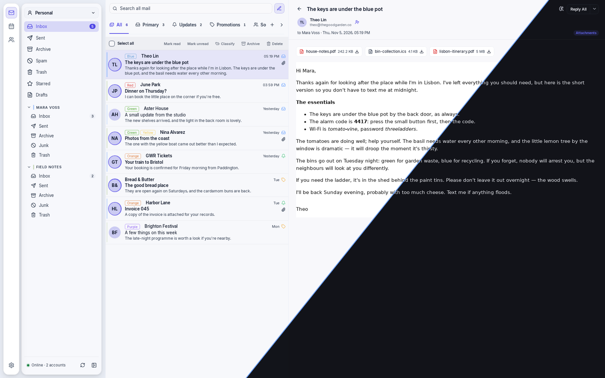
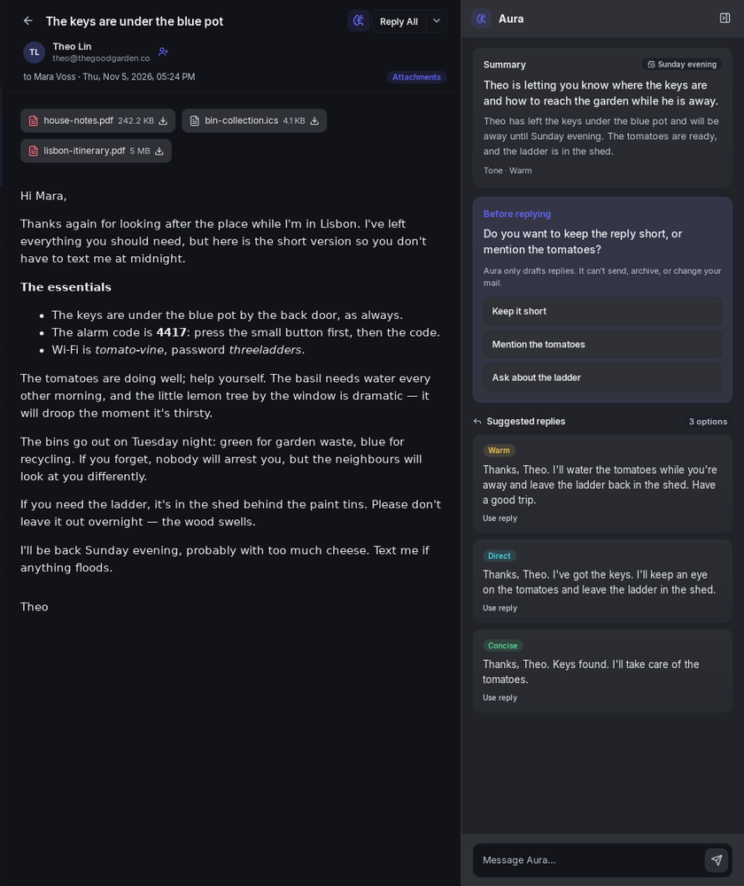

<h3 align="center">
   
  
</h3>

###### human made readme :)

## About

AuraMail is a cross platform email client built to be fast, modern, customizable and with powerful but unintrusive AI tools.

The purpose of this project is to borrow UX elements and features from other clients, add my own ideas and combine them in a unified and cohesive experience.

## Highlights

- IMAP/SMTP accounts
- Oauth support for Google and Microsoft
- Calendar and Contacts through CalDAV/CarDAV
- AI assisted compose and replies
- Categories, labels and extensive rule settings

## Disclaimer

AuraMail is an independent project developed by one person. It is still young, many features are still missing and more are subject to change. I don't believe AuraMail is currently ready for production use. User discretion is adviced

## Made to be accessible

AuraMail tries its best not to leave anyone behind. Under that premise, an ever growing list of accessibility settings have been implemented, from basic UI scaling to WCAG compliant text spacing to aid dyslexic people

## Highly customizable

AuraMail brings to the table a high level of customization, from default neutrals to famous color schemes. UI elements be customized to fit your style

And yes, there's matugen support too. You can find the template in ~/.config/auramail/theme.json

## Make space for spaces

Spaces are sandboxed environments where you can partition your daily life into tidy little boxes. Wether it's your personal life or work life, each space allows you to configure specific mail addresses and per-space settings. This includes themes, general settings and notifications. 

## Bring Proton with you

Auramail features oauth support for major players, but its most distinguished feature is a native integration with Proton Mail. **No paid accounts required**, no external bridges needed. Auramail takes care of that for you, so that you can enjoy your favourite mail provider without the forced compromises (and "please buy me" nags) of a web interface

## AuraAI

AuraAI is an optional companion ran through a local or an OpenAI cloud provider that can assist you in a variety of tasks:

- Automatic and granular email classification
- Context-aware reply drafting with integrated style and response suggestions
- Composition assistance featuring instruction-based generation and grammar/syntax correction

<h3 align="center">
   
</h3>

## Roadmap

* [x] IMAP/SMTP Accounts support.
* [~] Oauth with major providers (e.g. Google, Microsoft)
* [x] Native Proton Mail bridge with hydroxide (aka login with a free account)
* [x] Basic email workflow
* [x] Theming with Matugen support
* [x] AI: Mail sorting, context aware replies
* [x] System tray, notifications, send/receive sounds
* [x] Signatures
* [x] Support for local and cloud AI providers
* [x] Mail routing rules and labels
* [ ] CSD work
* [x] WCAG 1.4.12 compliance
* [ ] Localization support with human assisted translation
* [x] Calendar and contacts

## License

AuraMail is released under the [MIT License](LICENSE).

## Contributing

Contributions are welcome. If you find a bug or have a suggestion, feel free to open an issue, or reach out on our <a href="https://t.me/auramail">Telegram</a> channel

## ❤️ Gratitude
Thanks to the following tools developing this project is possible:

- <a href="https://tauri.app">Tauri</a>
- <a href="https://svelte.dev">Svelte</a>
- <a href="https://codeberg.org/emersion/hydroxide">Hydroxide</a>
