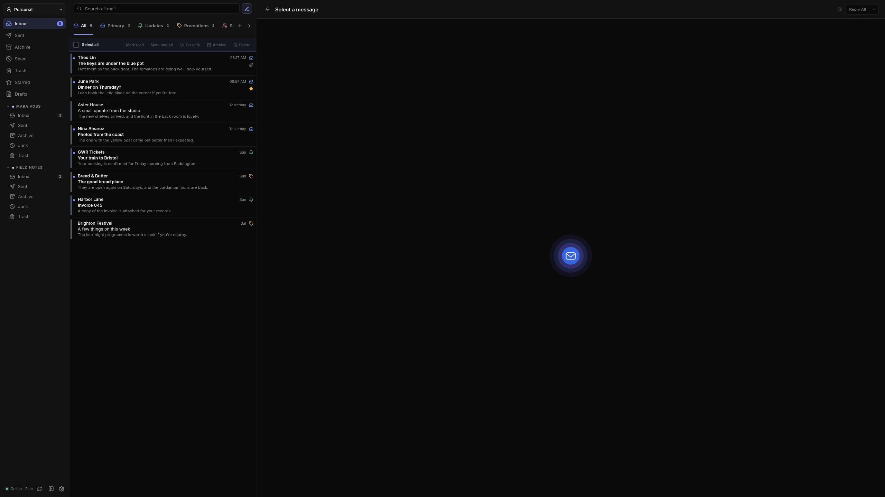
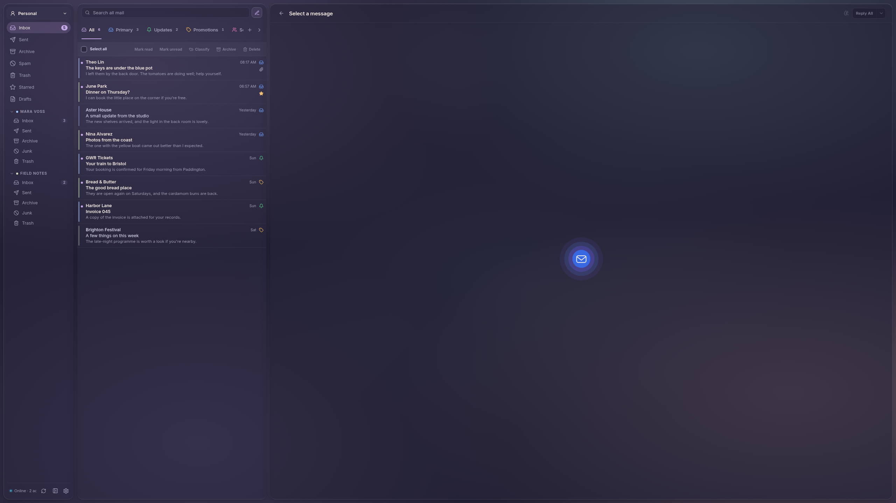
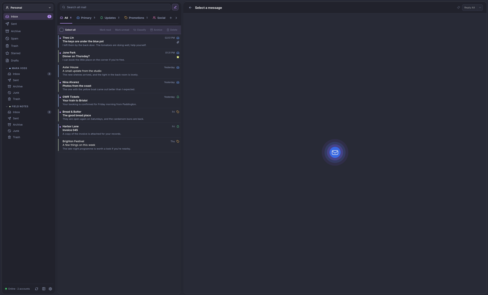
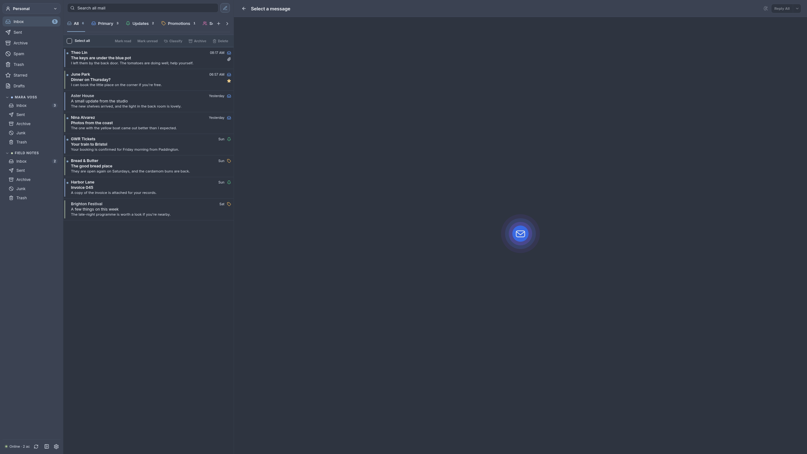
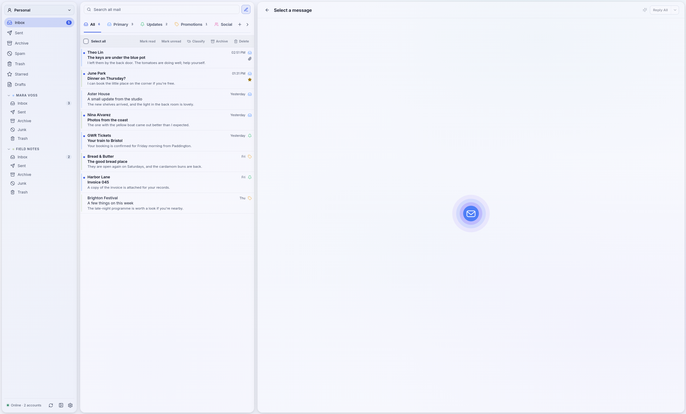
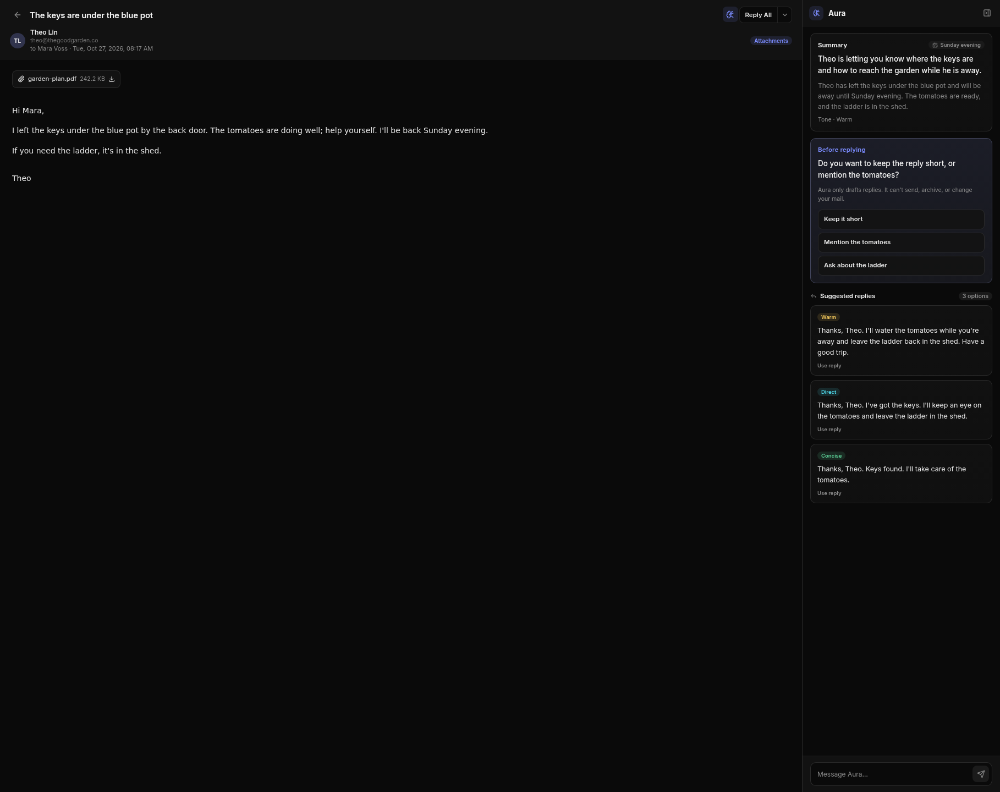

<h3 align="center">
   
  
</h3>

###### no ai was used to write this readme

## About

AuraMail is an email client built to be fast, modern, customizable and with powerful but unintrusive AI tools.

The purpose of this project is to borrow UX elements and features from other clients, add my own ideas and combine them in a unified and cohesive experience.

## Disclaimer

AuraMail is an independent project developed by one person. It is still young, many features are still missing and more are subject to change. I don't believe AuraMail is currently ready for production use. User discretion is adviced

## Made to be accessible

AuraMail boasts an ever growing list of accessibility settings meant to facilitate use to all users:

- UI scaling
- High Contrast mode
- Color blindness filters
- Motion sickness mitigation

More features coming soon

## Highly customizable

AuraMail brings to the table a high level of customization, from default neutrals to famous color palettes, with more to come. UI elements can also be customized to fit your style.

And yes, there's matugen support too. You can find the template in ~/.config/auramail/theme.json

Samples:
<h3 align="center">
   
   Rosepine - Rounded Glass  
  
   
   
   Dracula - Rounded Solid  

   
   
   Nord - Straight Solid  

   
   
   Light - Rounded Solid  
</h3>

## AuraAI

AuraAI is an optional companion ran through a local or an OpenAI cloud provider that can assist you in a variety of tasks:

- Automatic email classification
- Context and thread aware draft replies, with suggested responses and styles

<h3 align="center">
   
</h3>

## Roadmap

* [x] IMAP/SMTP Accounts support.
* [~] Oauth with major providers (e.g. Google, Microsoft)
* [x] Native Proton Mail bridge with hydroxide (aka login with a free account)
* [x] Basic email workflow
* [x] Theming with Matugen support
* [x] AI: Mail sorting, context aware replies
* [x] System tray, notifications, send/receive sounds
* [x] Signatures
* [x] Support for local and cloud AI providers
* [ ] Mail routing rules
* [ ] CSD work
* [x] WCAG 1.4.12 compliance
* [ ] Localization support with human assisted translation
* [~] Calendar and contacts

## License

AuraMail is released under the [MIT License](LICENSE).

## Contributing

Contributions are welcome. If you find a bug or have a suggestion, feel free to open an issue, or reach out on our <a href="https://t.me/auramail">Telegram</a> channel

## ❤️ Gratitude
Thanks to the following tools developing this project is possible:

- <a href="https://tauri.app">Tauri</a>
- <a href="https://svelte.dev">Svelte</a>
- <a href="https://codeberg.org/emersion/hydroxide">Hydroxide</a>
